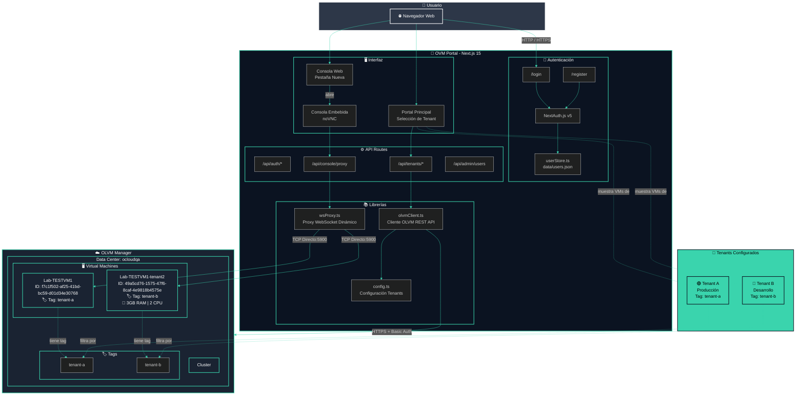
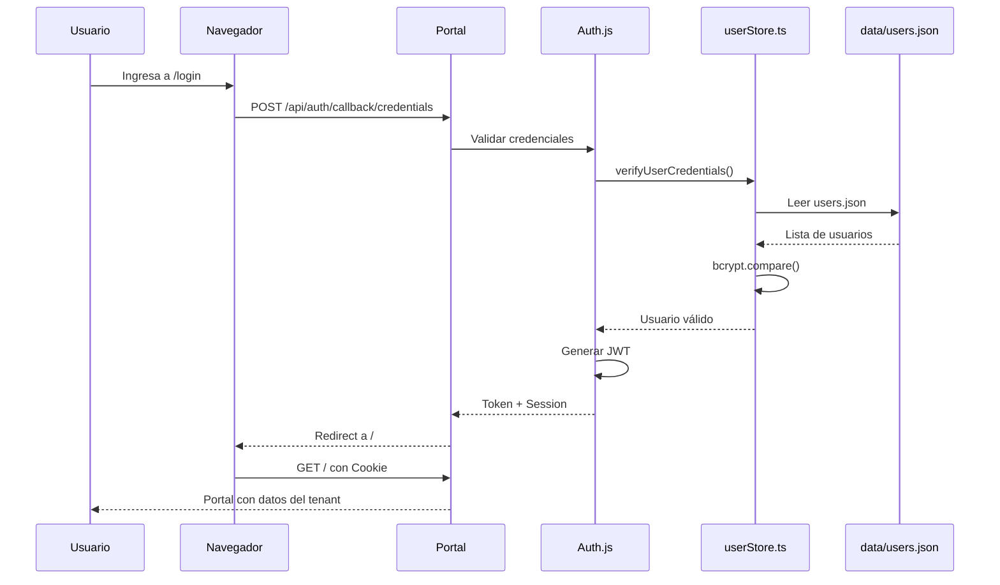
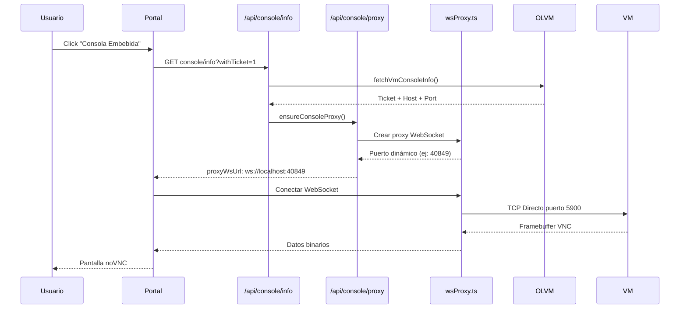
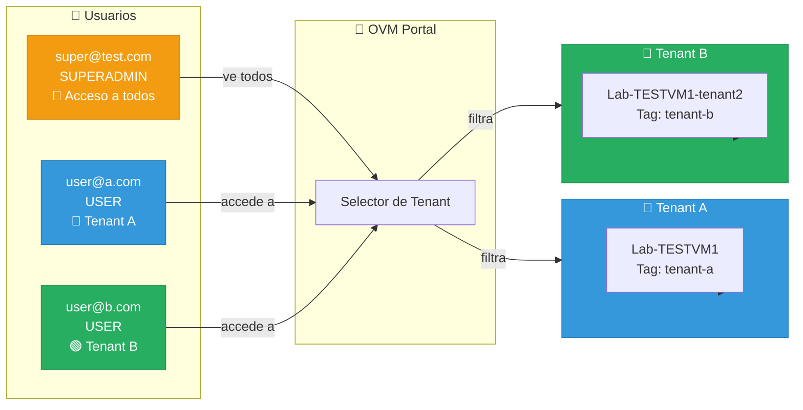
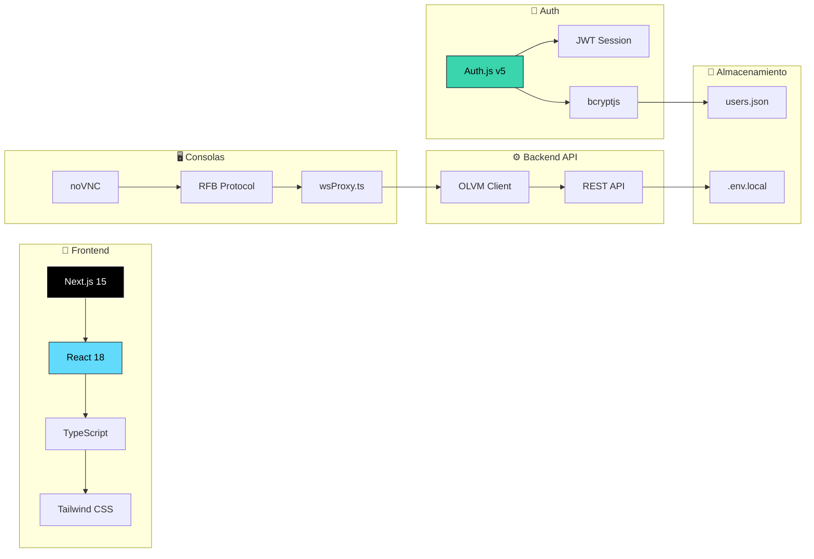
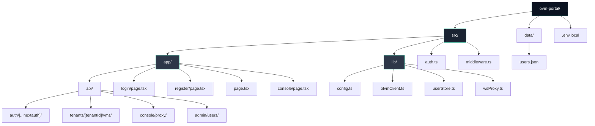
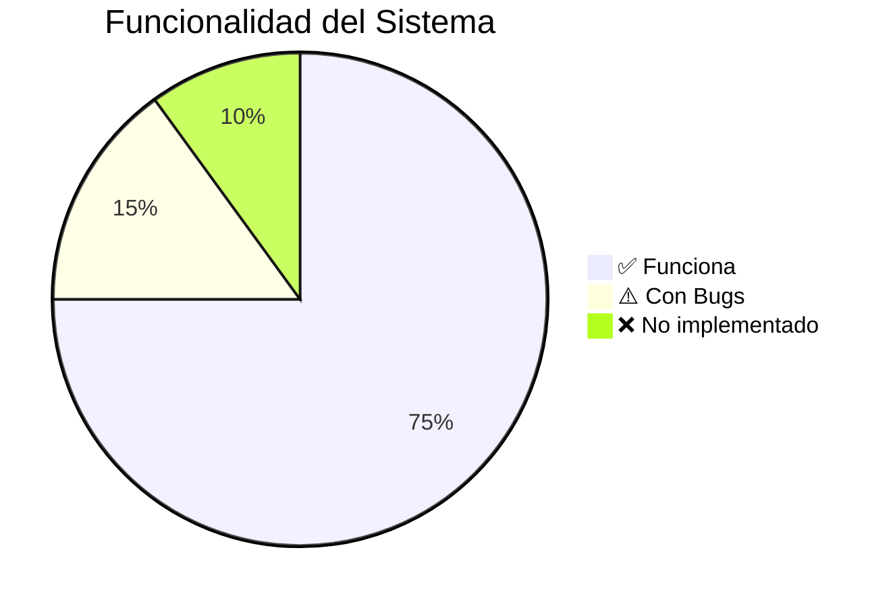

# Diagrama de Arquitectura - OVM Portal

## Diagrama General del Sistema

---

## Flujo de Autenticación

---

## Flujo de Consola VNC

---

## Estructura de Tenants

---

## Stack Tecnológico

---

## Mapa de Archivos

---

## Estado del Proyecto

### ✅ Funciona (75%)
- Login/Registro con Auth.js
- Selección de Tenant
- Listado de VMs
- Acciones básicas (start/stop)
- Consola embebida (intermitente)

### ⚠️ Con Bugs (15%)
- Consola embebida: desconexiones
- Consola web: no muestra imagen
- Proxy WebSocket: puertos dinámicos

### ❌ No implementado (10%)
- Filtro real por tags en API
- Dashboard con métricas
- Logs de auditoría

---

## Datos de Acceso

| Recurso | URL | Credenciales |
|---------|-----|--------------|
| **Portal** | http://localhost:3000 | super@test.com / password123 |
| **OLVM** | https://ocloudqa.sixmanager.cl | admin@internal / sixman123 |

---

*Generado: 2026-02-12*  
*Versión: OVM Portal Multitenant v1.0*
