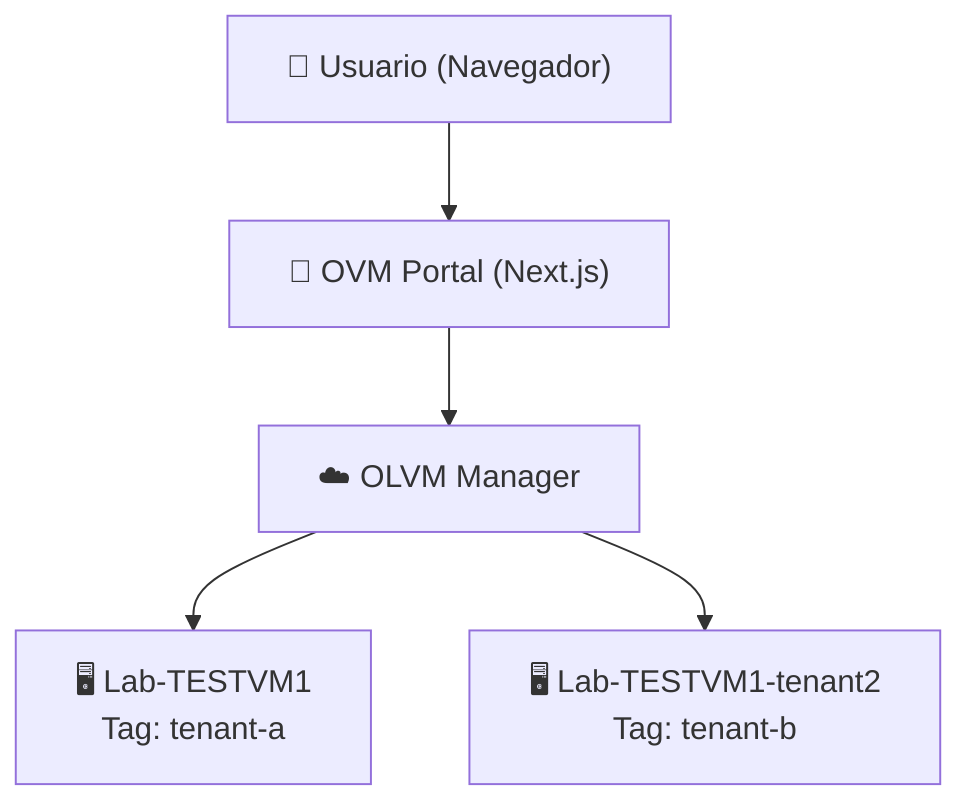

```
# Diagrama de Arquitectura - OVM Portal

## Diagrama General del Sistema


Stack Tecnológico

**Frontend**
• Tecnología: Next.js 15 + React 18 + TypeScript

**Estilos**
• Tecnología: Tailwind CSS

**Auth**
• Tecnología: Auth.js v5 (bcryptjs)

**Consolas**
• Tecnología: noVNC

**API**
• Tecnología: OLVM REST API

VMs en OLVM

**Lab-TESTVM1**
• ID: f7c1f502...
• Tag: tenant-a
• Recursos: Original

**Lab-TESTVM1-tenant2**
• ID: 49a5cd76...
• Tag: tenant-b
• Recursos: 3GB RAM, 2 CPU

URLs de Acceso

• **Portal:** http://localhost:3000
• **OLVM:** https://ocloudqa.sixmanager.cl
Tenants Configurados

• **Tenant A - Producción** → Filtra VMs con tag `tenant-a`
• **Tenant B - Desarrollo** → Filtra VMs con tag `tenant-b`

_Generado: 2026-02-13_

```

```
