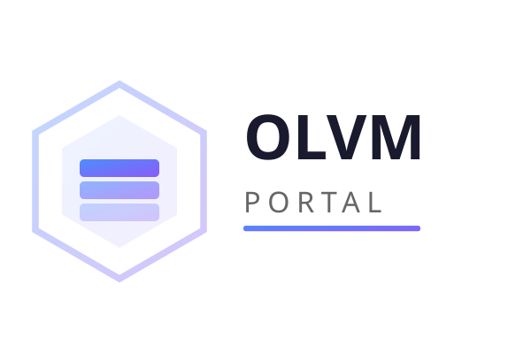
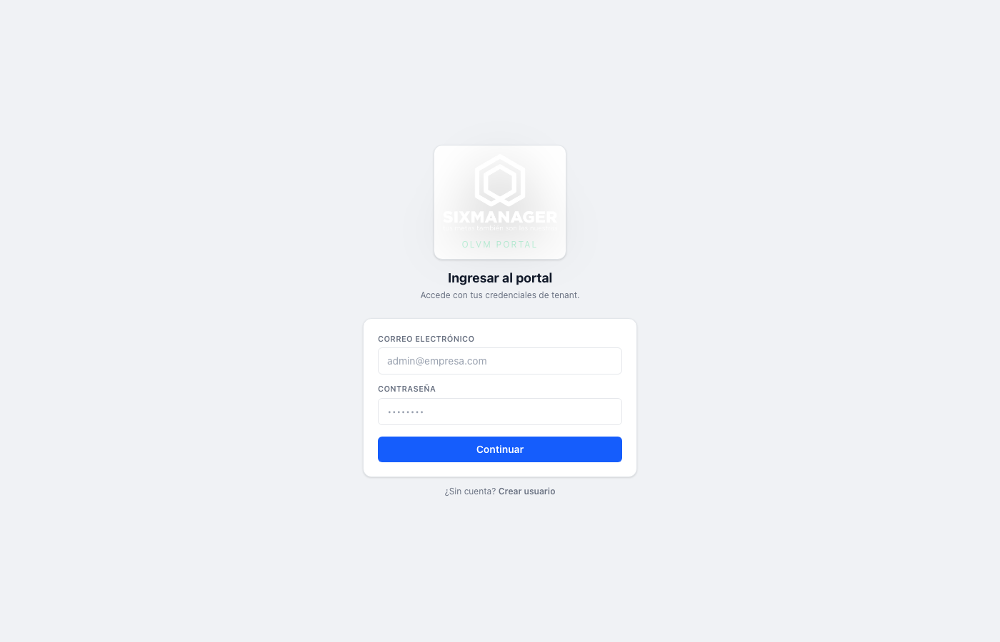
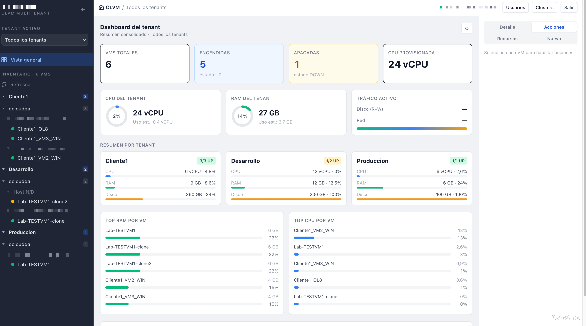
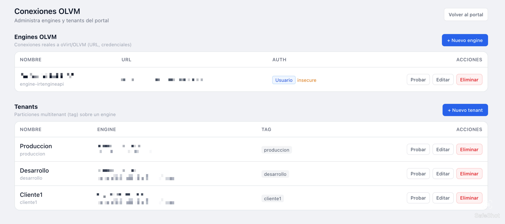
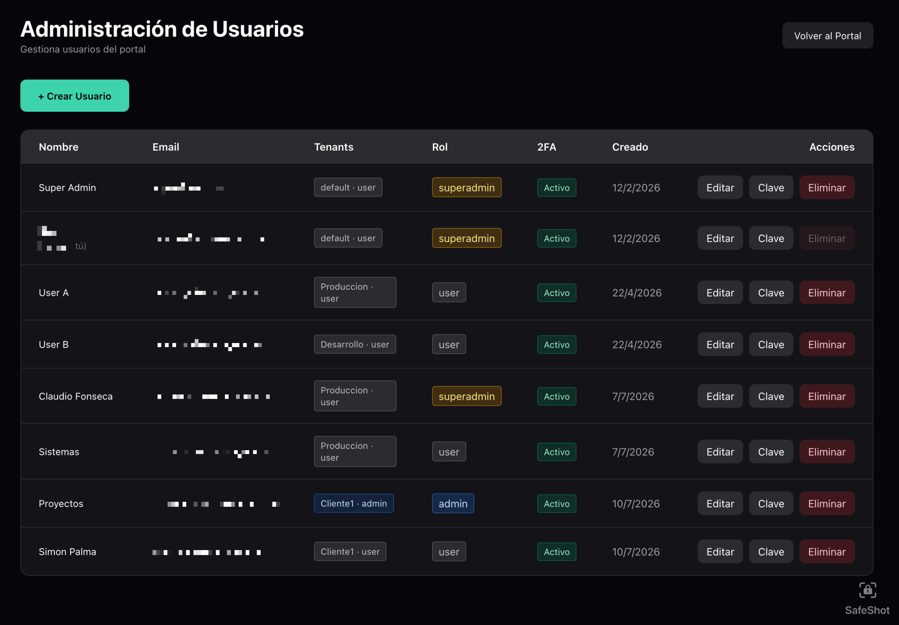

<p align="center">
  
</p>

# 🖥️ OLVM Portal

**Plataforma de administración multitenant para OLVM / oVirt**

Portal web self-service que permite gestionar máquinas virtuales, storage domains, ISOs y usuarios sobre motores OLVM/oVirt, con aislamiento por tenant y control de acceso basado en roles.

---

## 📸 Capturas

| Vista | Imagen |
|-------|--------|
| Login + 2FA |  |
| Dashboard |  |
| Gestión de VMs |  |
| Admin Tenants |  |
| Admin Usuarios |  |

## ✨ Características

### 📊 Dashboard Inteligente
- Métricas en tiempo real: CPU, RAM y almacenamiento por tenant
- Vista global "Todos los tenants" con tarjetas resumidas
- Donut charts y barras de uso por storage domain

### 🖥️ Gestión de VMs
- **Crear VMs** con selector de OS (Linux/Windows) que ajusta el hardware automáticamente
- **Ciclo de vida completo**: start, stop, shutdown, reboot, clonar, eliminar
- **Discos**: crear con interfaz VirtIO/SATA/IDE, eliminar, ver detalles
- **Recursos**: editar RAM y vCPU en caliente
- **Consola**: VNC embebida en el navegador + descarga de archivo `.vv`

### 💿 Storage Domains
- Asignación de SDs por tenant (filtrado de visibilidad)
- **SDs compartidos** por engine (ej: repositorio de ISOs visible para todos)
- Métricas correctas de espacio (available / used / total)

### 📀 Gestión de ISOs
- **Subir ISOs** al storage domain desde el portal (hasta 10GB, upload por chunks con barra de progreso)
- Montar/desmontar ISO en VMs (CD-ROM)
- Listado automático con refresh al abrir el dropdown
- Validación anti-duplicados

### 🔐 Instalación de Sistemas Operativos
- Flujo completo: crear VM → agregar disco → montar ISO → **encender desde CD** → instalar via consola
- Selector de OS define la interfaz de disco óptima (SATA para Windows, VirtIO para Linux)

### 👥 Multitenant & Seguridad
- **Engines separados de Tenants**: un engine sirve a N tenants sin duplicar credenciales
- **Tags de OLVM** para filtrado automático de VMs por tenant
- **Roles**: superadmin (global), admin/user (por tenant)
- **Memberships multi-tenant**: un usuario puede pertenecer a varios tenants
- **2FA** obligatorio vía email (Resend)
- Middleware que bloquea acceso cross-tenant

### ⚙️ Administración
- CRUD de Engines (URL, credenciales, CA cert, test de conexión, SDs compartidos)
- CRUD de Tenants (engine, tag, storage domains asignados)
- CRUD de Usuarios (memberships, 2FA, default tenant, reset password)

---

## 🛠️ Stack Tecnológico

| Capa | Tecnología |
|------|-----------|
| **Framework** | Next.js 15 (App Router, SSR) |
| **Lenguaje** | TypeScript |
| **UI** | React 19, Tailwind CSS |
| **Auth** | NextAuth.js (JWT + 2FA) |
| **2FA** | Resend (email OTP) |
| **Virtualización** | noVNC (consola embebida) |
| **API OLVM** | oVirt REST API v4 |
| **Runtime** | Node.js 22 |
| **Deploy** | Docker (standalone) |

---

## 🏗️ Arquitectura

```
┌──────────────────────────────────────────────────┐
│                   Browser (Cliente)                │
│  ┌──────────┐  ┌──────────┐  ┌─────────────────┐  │
│  │ Dashboard │  │ VM Panel │  │ Consola noVNC   │  │
│  └─────┬─────┘  └─────┬────┘  └────────┬────────┘  │
└────────┼──────────────┼───────────────┼───────────┘
         │              │               │
┌────────▼──────────────▼───────────────▼───────────┐
│              Next.js 15 (Server)                    │
│  ┌──────────┐  ┌──────────┐  ┌─────────────────┐  │
│  │ API Routes│  │ Auth/JWT │  │ WS Proxy (3010) │  │
│  └─────┬─────┘  └──────────┘  └─────────────────┘  │
│  ┌─────▼─────────────────────────────────────────┐ │
│  │  engineStore / clusterStore / userStore       │ │
│  │  (JSON file-based, seeding desde env vars)     │ │
│  └─────┬─────────────────────────────────────────┘ │
└────────┼────────────────────────────────────────────┘
         │
┌────────▼───────────────────────────────────────────┐
│            OLVM / oVirt Engine (REST API)           │
│  ┌─────────┐  ┌──────────┐  ┌──────────────────┐   │
│  │   VMs   │  │ Storage  │  │ Image Transfer   │   │
│  │ Disks   │  │ Domains  │  │ (ISO upload)     │   │
│  │ Tags    │  │ ISOs     │  │                  │   │
│  └─────────┘  └──────────┘  └──────────────────┘   │
└─────────────────────────────────────────────────────┘
```

---

## 🚀 Despliegue

### Prerrequisitos
- Docker instalado en el servidor
- Acceso al engine OLVM/oVirt (REST API)
- Servicio SMTP o API key de Resend para 2FA

### 1. Clonar y construir

```bash
git clone https://github.com/npalmae/olvm-portal.git
cd olvm-portal
docker build -t olvm-portal:latest .
```

### 2. Configurar variables de entorno

Crear archivo `.env`:

```bash
# Autenticación
AUTH_SECRET=tu-secreto-jwt
AUTH_TRUST_HOST=true
REQUIRE_2FA=true

# Email (2FA)
RESEND_API_KEY=re_xxxxxxxx
RESEND_FROM=noreply@tudominio.com

# Engines y Tenants
OLVM_TENANTS=[
  {"id":"produccion","name":"Produccion","baseUrl":"https://10.141.11.63/ovirt-engine/api","username":"admin@internal","password":"xxx","allowInsecure":true,"tag":"produccion","storageDomains":["DATA","ISOS"]},
  {"id":"desarrollo","name":"Desarrollo","baseUrl":"https://10.141.11.63/ovirt-engine/api","username":"admin@internal","password":"xxx","allowInsecure":true,"tag":"desarrollo"}
]

# Storage domains compartidos (visibles para todos los tenants)
OLVM_SHARED_SDS=["ISOS","REPOSITORIO"]
```

### 3. Ejecutar

```bash
docker run -d \
  --name olvm-portal \
  --restart unless-stopped \
  --network host \
  --env-file .env \
  olvm-portal:latest
```

Acceder a `http://<servidor>:3000`

---

## ⚙️ Variables de Entorno

| Variable | Descripción | Requerido |
|----------|-------------|-----------|
| `AUTH_SECRET` | Secreto para JWT | ✅ |
| `AUTH_TRUST_HOST` | Confía en el host (detrás de proxy) | ✅ |
| `REQUIRE_2FA` | Forzar doble factor | Recomendado |
| `RESEND_API_KEY` | API key de Resend para emails 2FA | Si 2FA activo |
| `RESEND_FROM` | Email remitente para 2FA | Si 2FA activo |
| `OLVM_TENANTS` | JSON con engines + tenants | ✅ |
| `OLVM_SHARED_SDS` | JSON con SDs compartidos globales | Opcional |
| `USER_STORE_PATH` | Path custom para users.json | Opcional |
| `ENGINE_STORE_PATH` | Path custom para engines.json | Opcional |

---

## 📖 Flujo de Trabajo

### Crear VM e instalar OS
```
1. Seleccionar tenant → tab "Nuevo"
2. Elegir OS (Linux/Windows), cluster, RAM, vCPU
3. Crear VM
4. Seleccionar VM → tab "Acciones"
5. Agregar disco (seleccionar interfaz según OS)
6. Montar ISO desde el dropdown
7. "Encender desde CD" (Run Once)
8. Abrir consola VNC → instalar OS
9. Apagar → encender normal
```

### Subir ISO al repositorio
```
1. Tab "Acciones" → sección ISO / CD-ROM
2. Click "↑ Subir ISO al storage domain"
3. Seleccionar archivo .iso
4. Barra de progreso muestra avance (upload por chunks de 50MB)
5. "Procesando en OLVM..." → Toast verde al completar
```

---

## 👤 Usuarios por Defecto

El sistema incluye usuarios seed en `data/users.json`:

| Email | Rol | Tenant |
|-------|-----|--------|
| `super@test.com` | superadmin | — |
| `npalma@sixmanager.com` | superadmin | — |

> Los nuevos usuarios creados desde el portal se persisten en `data/users.json` y sobreviven reinicios si se incluyen en el Docker image.

---

## 🔒 Seguridad

- **JWT stateless**: el token se genera al login y no consulta la DB en cada request
- **2FA**: código OTP por email en cada login
- **Aislamiento por tags**: las VMs se filtran por tag de OLVM, un tenant no puede ver VMs de otro
- **Middleware**: bloquea acceso a APIs de otros tenants (403 o redirect)
- **Credenciales centralizadas**: las credenciales del engine nunca se exponen a los usuarios

---

## 📂 Estructura del Proyecto

```
src/
├── app/
│   ├── page.tsx              # Dashboard principal (portal)
│   ├── layout.tsx            # Root layout (SessionProvider)
│   ├── login/                # Página de login
│   ├── register/             # Self-registration
│   ├── admin/
│   │   ├── clusters/         # Admin Engines + Tenants
│   │   └── users/            # Admin Usuarios
│   ├── api/
│   │   ├── admin/engines/    # CRUD engines + test + SDs
│   │   ├── admin/clusters/   # CRUD tenants
│   │   ├── admin/users/      # CRUD usuarios
│   │   └── tenants/[id]/
│   │       ├── vms/          # VMs + acciones + discos + cdrom
│   │       ├── isos/         # Listar + subir ISOs
│   │       ├── storage-domains/
│   │       └── provisioning-options/
│   └── console/              # Consola noVNC embebida
├── lib/
│   ├── olvmClient.ts         # Cliente REST API OLVM (VMs, discos, ISOs, tags)
│   ├── engineStore.ts        # Store de engines (JSON)
│   ├── clusterStore.ts       # Store de tenants (JSON)
│   ├── userStore.ts          # Store de usuarios (JSON + bcrypt)
│   ├── config.ts             # Resolver tenant → engine → TenantConfig
│   ├── authz.ts              # Helpers de autorización
│   └── wsProxy.ts            # Proxy WebSocket para consola VNC
├── auth.ts                   # NextAuth config
├── auth-base.ts              # Auth config (Edge compatible)
└── middleware.ts             # Protección de rutas + tenant guard
```

---

## 📜 Licencia

Propietario — SixManager

---

<p align="center">
  Desarrollado por el equipo de SixManager
</p>
